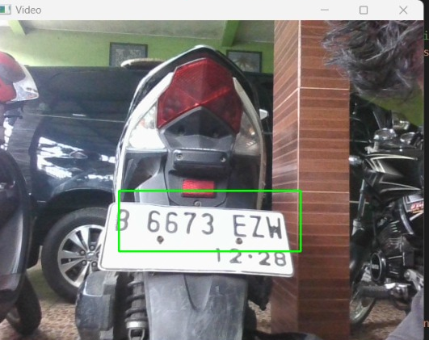
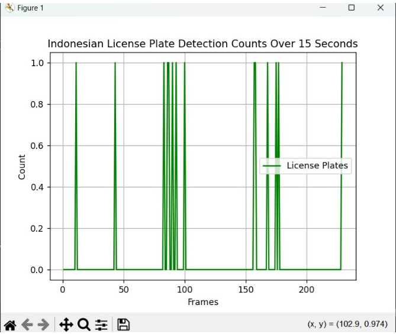

# Real-Time Indonesian License Plate Detection

A real-time Indonesian license plate detection application built with a Haar Cascade Classifier and OpenCV. It captures video from a webcam, marks detected plates on each frame, and plots the number of detections over the first 15 seconds. Detection then continues until the ESC key is pressed.

## Tech Stack

Python, OpenCV, Matplotlib, NumPy

## Results

